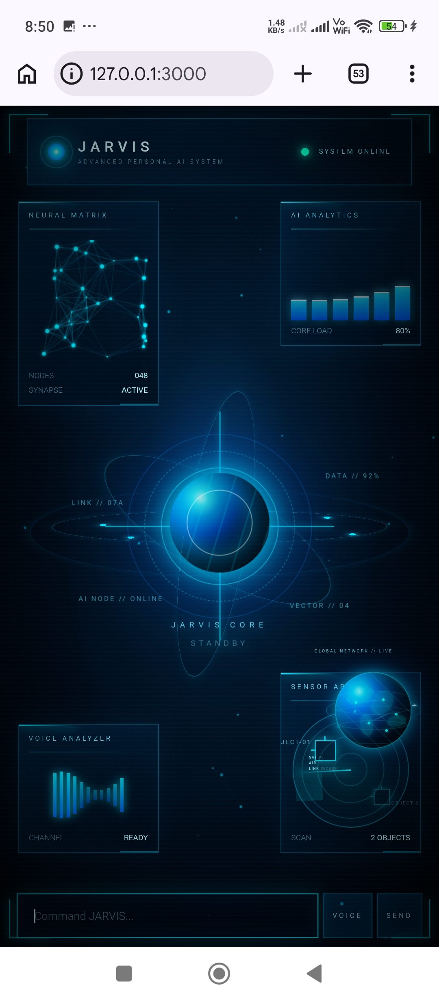

<div align="center">


# C.O.S.M.O.S.I.M &nbsp;·&nbsp; Android

### A futuristic, voice-driven **JARVIS HUD** in your pocket

*Neural Matrix · AI Analytics · Jarvis Core · Voice Analyzer · Sensor Array*


</div>

---

## Table of Contents

1. [Overview](#-overview)
2. [Preview](#-preview)
3. [Features](#-features)
4. [How It Works](#-how-it-works)
5. [Supported Apps & Voice Commands](#-supported-apps--voice-commands)
6. [Project Structure](#-project-structure)
7. [Getting Started](#-getting-started)
8. [Build an APK](#-build-an-apk)
9. [Configuration](#-configuration)
10. [Permissions](#-permissions)
11. [Customization](#-customization)
12. [Troubleshooting](#-troubleshooting)
13. [Roadmap](#-roadmap)
14. [Contributing](#-contributing)
15. [License](#-license)

---

## 🌌 Overview

**C.O.S.M.O.S.I.M Android** is the native Android shell for the **JARVIS-WEB** assistant. It wraps the live JARVIS HUD in a hardware-accelerated `WebView`, adds the Android permissions a voice assistant needs (microphone, camera, location, file access) and launches installed apps directly from commands.

It does **not** modify the JARVIS-WEB web repository. Android-specific behaviour is injected at runtime by the wrapper, so the web UI and the app stay in sync.

> **Note:** this is an **online** wrapper. The HUD is loaded from GitHub Pages, the backend runs on Render and AI replies come from Gemini, so an internet connection is required.

---

## 🖼 Preview

<div align="center">



*The JARVIS HUD: command input with VOICE and SEND controls sits clear of the system navigation bar.*

</div>

---

## ✨ Features

| | Feature | Details |
|---|---|---|
| 🎙 | **Voice control** | Microphone permission is handled natively so the web voice features work inside the app |
| ⌨️ | **Command panel** | Type commands and press **SEND**, or tap **VOICE** to speak |
| 🧠 | **Gemini 2.5 Flash** | Direct personal-key Gemini requests are pinned to `gemini-2.5-flash` |
| 🚀 | **Native app launching** | Opens YouTube, Spotify, WhatsApp and more in their Android apps when installed |
| 🌐 | **Web fallback** | If an app is missing, the web version opens inside the WebView |
| 📷 | **Camera & files** | Camera access and a file chooser are supported |
| 📍 | **Location** | Geolocation is enabled for the HUD |
| 📱 | **Safe layout** | The page respects the status bar, navigation bar, display cutouts and on-screen keyboard |
| 🔌 | **JavaScript bridge** | `AndroidJARVIS.open(url)` lets the web UI trigger native launches |
| 🎨 | **Custom icon** | Standard, round and adaptive launcher icons |
| ↩️ | **Smart back button** | Navigates back in the WebView, then exits |
| 🌑 | **Dark system bars** | Matches the HUD colour `#00040A` |

---

## ⚙️ How It Works

```
┌──────────────────────────┐
│   Android App (Java)     │
│  ┌────────────────────┐  │      ┌────────────────────────┐
│  │      WebView       │──┼────► │ GitHub Pages: JARVIS-WEB│
│  └─────────┬──────────┘  │      └────────────────────────┘
│            │             │      ┌────────────────────────┐
│  UI patch (assets) ──────┼────► │ Render backend  /api/… │
│  Permission handling     │      └────────────────────────┘
│  Native app launcher     │      ┌────────────────────────┐
└──────────────────────────┘      │ Gemini 2.5 Flash API   │
                                  └────────────────────────┘
```

1. `MainActivity` creates the `WebView` and loads the live JARVIS-WEB URL with the backend passed as the `api` parameter.
2. A request for `jarvis-ui-patch.js` is intercepted and served from `assets/jarvis-ui-patch-gemini25.js`.
3. The patch adjusts bridge-panel spacing, pins Gemini to 2.5 Flash and intercepts "open …" commands.
4. Links are routed through `openNativeOrWeb()`, which tries the installed app first and falls back to the web.

---

## 🗣 Supported Apps & Voice Commands

Say or type commands such as:

```
open youtube
launch spotify
go to google maps
open gmail
show calendar
```

| Category | Apps |
|---|---|
| **Google** | YouTube, Google, Maps, Gmail, Drive, Photos, Docs, Sheets, Slides, Calendar, Meet, Translate |
| **Media** | Spotify, Netflix |
| **Work** | Microsoft Teams, Outlook, OneDrive, Notion, Slack, Zoom |
| **Social** | WhatsApp, Instagram, Facebook / Messenger, Telegram, X (Twitter), Reddit, Discord |
| **Shopping** | Amazon |

Also supported: `open browser`, `open web browser`, `open internet`.

---

## 📁 Project Structure

```
C.O.S.M.O.S.I.M-android/
├── app/
│   ├── build.gradle
│   ├── proguard-rules.pro
│   └── src/main/
│       ├── AndroidManifest.xml
│       ├── assets/
│       │   └── jarvis-ui-patch-gemini25.js   # runtime UI + Gemini + launcher patch
│       ├── java/com/anuveytq/jarvisweb/
│       │   └── MainActivity.java             # WebView, permissions, insets, launcher
│       └── res/
│           ├── mipmap-*/                     # launcher icons
│           ├── mipmap-anydpi-v26/            # adaptive icons
│           └── values/                       # colors, theme
├── docs/                                     # README images
├── build.gradle
├── settings.gradle
├── gradle.properties
├── LICENSE
└── README.md
```

---

## 🚀 Getting Started

### Requirements

- **Android Studio** (recent stable version)
- **JDK 17**
- An Android device or emulator running **Android 6.0 (API 23)** or newer
- Your own **Gemini API key** (entered in JARVIS Settings)

### Run it

```bash
git clone https://github.com/anuveytq-sys/C.O.S.M.O.S.I.M-android.git
cd C.O.S.M.O.S.I.M-android
```

1. Open the folder in **Android Studio**.
2. Let **Gradle sync** finish.
3. Connect a device (or start an emulator) and press ▶ **Run**.
4. Allow the microphone, camera and location permissions when asked.

---

## 📦 Build an APK

1. **Build → Generate Signed Bundle / APK…**
2. Choose **APK** for direct install, or **Android App Bundle** for the Play Store.
3. Create or select a keystore and finish the wizard.

> Keep your keystore private. `*.jks` and `*.keystore` are already in `.gitignore`.

---

## 🔧 Configuration

| What | Where | Value |
|---|---|---|
| Web app and backend URL | `MainActivity.java` → `JARVIS_URL` | GitHub Pages + `?api=` Render URL |
| Gemini model | `assets/jarvis-ui-patch-gemini25.js` → `FORCED_GEMINI_MODEL` | `gemini-2.5-flash` |
| App name | `AndroidManifest.xml` → `android:label` | `JARVIS` |
| Package id | `app/build.gradle` | `com.anuveytq.jarvisweb` |
| Bottom spacing | `MainActivity.java` → `extraBottomPx` | `10dp` |
| Bridge panel position | `jarvis-ui-patch-gemini25.js` | CSS `bottom` values |

---

## 🔐 Permissions

| Permission | Why |
|---|---|
| `INTERNET` | Load the HUD, backend and Gemini |
| `RECORD_AUDIO` | Voice commands |
| `CAMERA` | Camera features in the HUD |
| `ACCESS_FINE_LOCATION` / `ACCESS_COARSE_LOCATION` | Location-aware features |

Permissions are requested at launch and only granted to the WebView when Android has granted them.

---

## 🎨 Customization

- **Change the icon:** replace the PNGs in `res/mipmap-*` and the adaptive foreground, or regenerate them from your own image.
- **Change the colours:** edit `res/values/colors.xml` and `themes.xml`.
- **Add an app to the launcher:** add a package in `packageForHost()` (`MainActivity.java`) and an entry in the `apps` list of the patch file.

---

## 🛠 Troubleshooting

| Problem | Fix |
|---|---|
| Blank screen | Check your internet connection. The Render backend may need a moment to wake up |
| Microphone does nothing | Allow the microphone permission in Android Settings → Apps → JARVIS |
| Command bar hidden or overlapping | Make sure you are on the latest build, which includes the insets fix |
| App link opens the web version | The native app is not installed or has no compatible intent |
| Gemini errors | Check the API key in JARVIS Settings |

---

## 🗺 Roadmap

- [ ] Offline wake-word support
- [ ] Optional on-device speech recognition
- [ ] Home-screen widget
- [ ] Notification quick actions
- [ ] More native app shortcuts

---

## 🤝 Contributing

Contributions are welcome.

1. Fork the repository
2. Create a branch: `git checkout -b feature/my-feature`
3. Commit: `git commit -m "Add my feature"`
4. Push: `git push origin feature/my-feature`
5. Open a Pull Request

---

## 📄 License

Released under the **MIT License**. See [`LICENSE`](LICENSE).

<div align="center">

**Built with ⚡ by [anuveytq-sys](https://github.com/anuveytq-sys)**

*If you like this project, give it a ⭐*

</div>
